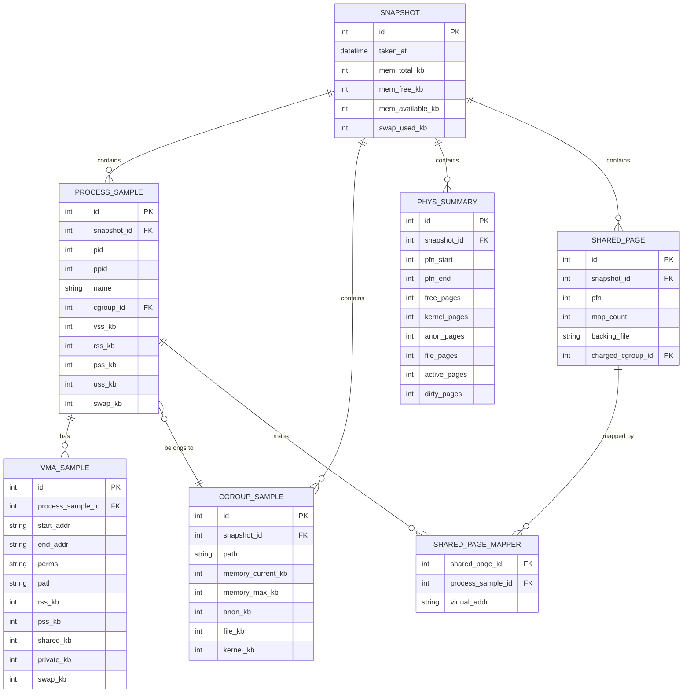
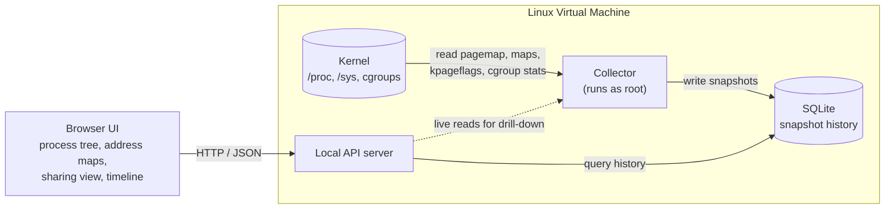

# Memory Observability Tool

A browser-based tool for seeing where a Linux machine's memory actually goes: which processes own it, which processes share it, and how it changes over time.

## Project Purpose

Tools like `top` and `htop` give you a handful of numbers per process (VSS, RSS) that are easy to misread. RSS counts a shared library's pages in full for every process that uses it, and "virtual size" says almost nothing about real RAM use. The kernel actually exposes a lot more detail, but it is spread across many `/proc` and `/sys` files that are hard to read by hand.

This project collects that data, stores snapshots of it, and shows it visually so a person can answer questions like:

- Which processes share the same physical page?
- What does a process's virtual address space look like, and which parts are really in RAM?
- Is a page resident, swapped out, or never touched?
- Which container (cgroup) is being charged for this memory?
- How did a process's memory change over time?

## Background: What the Tool Shows

```
 Virtual address space (one process)                Physical RAM (whole machine)
 ┌──────────────────────────────┐                   ┌─────────────────────────────┐
 │ code        [██████░░░░]     │                   │ ▓▓▓▓ kernel                 │
 │ heap        [███░░░░░░░]     │ ───page tables──▶ │ ████ process-owned          │
 │ libc.so     [████████░░]  ◀──┼── shared by 12    │ ▒▒▒▒ file cache (shared)    │
 │ stack       [██░░░░░░░░]     │   processes       │ ░░░░ free                   │
 └──────────────────────────────┘                   └─────────────────────────────┘
   █ in RAM   ░ not in RAM (never touched / swapped)
```

Key ideas the tool is built around:

- **Virtual vs. physical:** each process sees its own private virtual addresses. The kernel's page tables translate these to real physical pages. If two processes' tables point at the same physical page, they share it.
- **Page states:** a page is reserved (never touched), resident (in RAM), swapped out, or freed. Resident pages can also be dirty or clean, active or inactive, and shared or private.
- **Better usage numbers:** RSS counts shared pages in full, PSS splits shared pages fairly between sharers, and USS counts only memory that would be freed if the process exited.
- **cgroups:** the kernel charges memory to a cgroup (a container is basically one). A shared page is charged to a single cgroup, which is often different from the processes that map it.

## Features

### Core
1. **Process tree:** who started whom, with per-process memory summary (VSS, RSS, PSS, USS, swap).
2. **Virtual address map:** a process's regions (code, heap, stack, shared libraries, mapped files) drawn as colored bars, with how much of each region is actually in RAM.
3. **Per-page state:** zoom into a region and see each page as untouched, resident, or swapped.
4. **Physical memory map:** RAM drawn as a grid, with each cell colored by what the page is (free, kernel, file cache, process-owned) and whether it is active or inactive, dirty or clean.
5. **Sharing view:** pick a physical page, library, or region and see every process that maps it.
6. **Snapshot history:** take snapshots over time and store them so memory changes can be replayed.

### Stretch
7. **cgroup / container view:** group processes by cgroup, show each group's memory usage and breakdown, and show which cgroup is charged for shared pages.
8. **Lifecycle timeline:** chart one process's memory (resident, swapped, shared) across snapshots, highlighting growth and sudden changes.
9. **Snapshot diff:** compare two snapshots and show what was allocated, freed, or swapped.

## Where the Data Comes From

| Data | Source (Linux) |
|---|---|
| Process tree | `/proc/PID/status` (`PPid`) |
| Virtual regions | `/proc/PID/maps`, `/proc/PID/smaps` |
| Per-page state and physical page numbers | `/proc/PID/pagemap` (needs root) |
| Sharing counts and page flags | `/proc/kpagecount`, `/proc/kpageflags` (needs root) |
| Physical memory layout | `/proc/iomem` |
| System totals | `/proc/meminfo` |
| cgroup usage and ownership | `/sys/fs/cgroup/...`, `/proc/kpagecgroup` |

The tool will run on a virtual machine for now, so root access is available for the physical page data.

## Initial ERD Sketch

Full per-page data for every process would be enormous, so snapshots store region-level summaries plus detail only where it is interesting (pages shared by more than one process, and pages in a region the user drills into).



## Rough System Design

The frontend is not final. A browser UI is the leading option because it handles interactive, zoomable visualizations well, but that choice may change.



How it works:
1. The **collector** reads the kernel's files on demand or on a timer and writes a snapshot to **SQLite**.
2. The **API server** answers queries from the database, and asks the collector for live detail when the user zooms into a specific process or region.
3. The **browser UI** renders the views and lets the user pick processes, regions, and snapshots.

## Initial Daily Goals

The end-of-class date is not fixed here, so these are numbered by working session. Adjust the count to match the schedule.

| Day | Goal |
|---|---|
| 1 | Finalize this proposal. Set up the VM and repo. Write a script that reads `/proc/PID/status` and `maps` for one process. |
| 2 | Collector reads the process list and builds the process tree with VSS, RSS, PSS, and USS from `smaps`. |
| 3 | Create the SQLite schema and save a full snapshot of processes and regions. |
| 4 | Start the API server with endpoints for the process tree and a process's regions. Browser page showing the process tree. |
| 5 | Virtual address map view: colored bars per region with resident fraction. |
| 6 | Read `pagemap` for a selected region and show per-page state (untouched, resident, swapped). |
| 7 | Read `kpageflags` and `/proc/iomem` and build the physical memory map view. |
| 8 | Build the reverse index (physical page to processes) and the sharing view, starting with shared libraries. |
| 9 | Add cgroup data and group the process tree and physical map by cgroup. |
| 10 | Add timed snapshots and the timeline view for one process. |
| 11 | Snapshot diff, performance tuning of full scans, and bug fixes. |
| 12 | Polish the UI, write documentation, and prepare the demo. |

If time runs short, the cgroup view, timeline, and snapshot diff are the first things to cut. The process tree, address maps, and sharing view are the heart of the project.